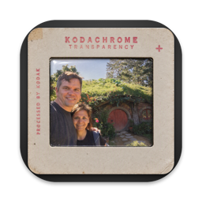

# Slides

A macOS app that makes it easy to turn a list of photos into a **Ken Burns–style slide show**: each photo slowly zooms or pans, cross-fades into the next, and plays over your music. When it looks right, export a 1080p MP4 movie.

The goal is to need as little fiddling as possible. Video editors like Final Cut Pro make you set up the motion for each photo by hand, and redo it whenever you insert, delete or reorder photos. In Slides:

- **Zoom direction alternates automatically** by position (in, out, in, out…), so reordering never breaks the rhythm.
- **Every photo gets a gentle default zoom** (5%) toward its faces, found automatically.
- **Scanned prints lose their white borders** with one menu command.
- **Durations, cross-fades and music** are laid out on a timeline and adjust themselves as the show changes.

## Features

- **Photo list:** drag in photos or whole folders; reorder by dragging; cut, copy and paste; multi-select with ⌘-click and Shift-click.
- **Per-photo framing:**
  - An outer rectangle (the most of the photo ever shown, in the movie's 16:9 shape).
  - An inner rectangle (the outer one zoomed toward a focus point).
  - Or pan between two rectangles instead.
  - Edits apply to every selected photo at once.
- **Face finding:** points the zoom at the faces in each photo (between them, if there are several).
- **Border trimming:** crops the white or yellowed border off scanned prints, so it doesn't show.
- **Timeline:**
  - Drag photos to reorder them, or drag a photo's edge to show it longer or shorter.
  - Drop music onto it, then move and trim the music, with a waveform to show where to cut.
  - Split the music at the playhead with ⌘B.
  - Adjust each clip's gain and fades. Trimmed ends fade automatically, so music never cuts off abruptly.
  - Zoom in and out.
- **Preview** at 1× to 8× speed, with cross-fades and music.
- **Export** to H.264 1080p MP4 with AAC audio, and the music fades out at the end.
- **Documents** (`.slides`) refer to your photos where they are, or can copy them inside so the show is self-contained.

Choose **Help › Slides Help** (⌘?) in the app for how everything works and the full list of keyboard shortcuts.

## Keyboard shortcuts

| Keys | Action |
| --- | --- |
| Space | Play or stop (stopping returns to the photo that was showing) |
| ← → | Previous or next photo |
| [ ] | Play slower or faster (up to 8×) |
| \ | Play at normal speed |
| - = (or ⌘- ⌘=) | Zoom the timeline out or in |
| ⌘-click, Shift-click | Add to the selection, or select a run of photos |
| ⌘A | Select all |
| Delete | Remove the selected photos or music |
| ⌘B | Split the music at the playhead |
| ⌘? | Show help |

## Building

Requires macOS 15 or later and Xcode 16 or later.

Open `Slides.xcodeproj` in Xcode and run it, or build from the command line:

```sh
xcodebuild -project Slides.xcodeproj -scheme Slides -derivedDataPath build/DerivedData build
open build/DerivedData/Build/Products/Debug/Slides.app
```

## How it's built

Swift and SwiftUI, with no third-party dependencies.

- **Preview and export** share one Core Image renderer (Metal for the preview, AVAssetWriter for the export), so the movie matches what you see.
- **Faces** are found with the Vision framework.
- **Music** is mixed with AVFoundation.
